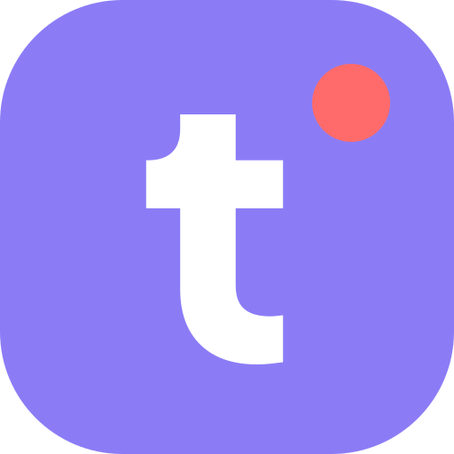

# Teamping — plugin for Claude Code, Cursor, Antigravity and Grok

Everyone keeps the AI they already use. Once each person connects it, the team lead's screen shows
who is working on what. With the plugin on, an edit stops before it touches a file a teammate's agent
is holding.

*This repository holds the plugins. The service runs at [teamping.dev](https://teamping.dev).*

[한국어](https://github.com/serion-mark/teamping-plugin/blob/main/plugin/README.ko.md)

## What changes

| | Today | With Teamping |
|---|---|---|
| The lead wants to know what the team is doing | Asks each person, who asks their own AI, and writes it up | One screen lists who is working on what, in which project |
| Two agents open the same file | Both edit it; you find out when you merge | The one that comes second stops before editing and says who is holding the file |
| A teammate's agent needs yesterday's decision | Someone pastes it across | Their agent reads it from the same project |

## Install

| Tool | Connect (MCP) | Auto-lock plugin |
|---|---|---|
| Claude Code | `claude mcp add --transport http teamping https://teamping.dev/mcp` then sign in | `/plugin marketplace add serion-mark/teamping-plugin` `/plugin install teamping@teamping` |
| Codex | `codex mcp add teamping --url https://teamping.dev/mcp` then sign in | not available yet |
| Cursor | key from Teamping | see [cursor-plugin/teamping](https://github.com/serion-mark/teamping-plugin/blob/main/cursor-plugin/teamping/README.md) |
| Antigravity | sign in (checked on CLI 1.5.8) or key | key connections only — see [antigravity-plugin/teamping](https://github.com/serion-mark/teamping-plugin/blob/main/antigravity-plugin/teamping/README.md) |
| Grok Build | key from Teamping | `grok plugin marketplace add serion-mark/teamping-plugin` `grok plugin install teamping@teamping-plugin --trust` |
| ChatGPT, Claude chat | add `https://teamping.dev/mcp` and sign in | not needed — chat apps don't edit files |

Signing in is also where you create an account if you don't have one yet.
Step-by-step setup for each tool: https://teamping.dev/connect

Want your AI to do the setup instead? Give it this address and say "read this and let's start Teamping":
https://teamping.dev/guide.md

**What you need:** a Teamping project, and `node` (it comes with Claude Code) plus `jq` and `curl`
for the session-start briefing. Without them the hooks do nothing and never block your session.

After you install the Claude Code plugin you pick an automation level (below), then connect this
repository to a project in the Teamping web app, on the **Live** tab. Until it is connected the hooks
pass through silently. Hooks are read when a window opens, so it takes effect from the next window.

## Automation level (`automation_level`, chosen at install)

| Level | What it does | Hooks that run |
|---|---|---|
| `lv0` | Off | none |
| `lv1` | Manual. Teamping moves only when you ask for it | none (prompt only) |
| `lv2` | Auto-read. Team situation on session start, who is online, file locks, a record of the files your AI edits, Teamping notices for this window | SessionStart · PreToolUse · PostToolUse · UserPromptSubmit · Stop · SessionEnd |
| `lv3` | Active. lv2 plus a "did you record it?" reminder when a response ends | lv2 + the Stop reminder |

## What this plugin sends

File paths, tool names, timestamps and the order things happened in. **Never file contents** — and
never your source code, command text, tool output, your conversation, prompts, environment variables,
API keys or commit messages. Every field it does send is listed in [DATA.md](https://github.com/serion-mark/teamping-plugin/blob/main/plugin/DATA.md).

## If something fails

Every hook exits `0` on any failure — no token, offline, API error. It never blocks your session.
The one thing a hook can deny is an edit to a file someone else is holding, and the agent is told
why so it can pick another file. Confirming a completion report is something only a person does, in the web app.

## About this repository

Generated from the Teamping product repository every time a plugin version changes. Open issues
here; code changes are made upstream. `plugin/.claude-plugin/releases.json` is the release ledger:
one line per version with a content hash and a note. `claude plugin update` picks up a new version
only when that version string changes.

Questions: support@teamping.dev, or **Contact us** in the web app.

License: MIT.

Teamping is a paid service for teams. Standard is free for 14 days with no card, one trial per
person — [pricing](https://teamping.dev/pricing).
