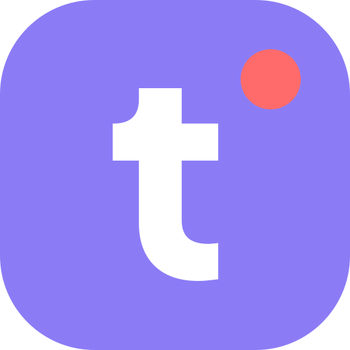

# 팀핑 — Claude Code · Cursor · Antigravity · Grok 플러그인

팀원들이 각자 쓰던 AI를 바꿀 필요 없어요. 연결만 하면 팀장님 화면에 누가 뭘 하는지 보여요.
플러그인을 켜면 동료의 AI가 잡고 있는 파일 앞에서 내 AI가 고치기 전에 멈춰요.

*이 저장소에는 플러그인이 들어 있어요. 서비스는 [teamping.dev](https://teamping.dev)에 있어요.*

[English](https://github.com/serion-mark/teamping-plugin/blob/main/plugin/README.md)

## 무엇이 달라지나

| | 지금 | 팀핑을 쓰면 |
|---|---|---|
| 팀장님이 「지금 다들 뭐 해요?」 하고 물을 때 | 한 사람씩 묻고, 그 사람은 자기 AI에게 묻고, 다시 정리해요 | 한 화면에 누가 어느 프로젝트에서 무엇을 하는지 나와요 |
| 두 AI가 같은 파일을 열 때 | 둘 다 고치고, 합칠 때 알게 돼요 | 나중에 고치려는 쪽이 고치기 전에 멈추고, 누가 잡고 있는지 알려 줘요 |
| 동료의 AI가 어제 정한 것을 알아야 할 때 | 누군가 복사해서 옮겨요 | 그 AI가 같은 프로젝트에서 읽어요 |

## 설치

| 도구 | 연결(MCP) | 자동 잠금 플러그인 |
|---|---|---|
| Claude Code | `claude mcp add --transport http teamping https://teamping.dev/mcp` 뒤 로그인 | `/plugin marketplace add serion-mark/teamping-plugin` `/plugin install teamping@teamping` |
| Codex | `codex mcp add teamping --url https://teamping.dev/mcp` 뒤 로그인 | 아직 준비 중이에요 |
| Cursor | 팀핑에서 받은 열쇠 | [cursor-plugin/teamping](https://github.com/serion-mark/teamping-plugin/blob/main/cursor-plugin/teamping/README.md) |
| Antigravity | 로그인(CLI 1.5.8에서 확인) 또는 열쇠 | 열쇠로 연결했을 때만 돼요 — [antigravity-plugin/teamping](https://github.com/serion-mark/teamping-plugin/blob/main/antigravity-plugin/teamping/README.md) |
| Grok Build | 팀핑에서 받은 열쇠 | `grok plugin marketplace add serion-mark/teamping-plugin` `grok plugin install teamping@teamping-plugin --trust` |
| ChatGPT · Claude 채팅 | `https://teamping.dev/mcp`를 더하고 로그인 | 필요 없어요 — 채팅 앱은 파일을 고치지 않아요 |

계정이 없으면 이 로그인 단계에서 만들면 돼요.
도구별로 하나씩 따라 하는 안내: https://teamping.dev/connect

내 AI에게 맡기고 싶으면 이 주소를 주고 「이거 보고 팀핑 시작하자」라고 하세요:
https://teamping.dev/guide.md

**필요한 것:** 팀핑 프로젝트 하나, 그리고 `node`(Claude Code와 함께 깔려요) · `jq` · `curl`
(세션 시작 브리핑에 써요). 없어도 훅은 아무 일도 하지 않고 세션을 막지도 않아요.

Claude Code 플러그인을 깔면 자동화 세기를 고르고(아래), 팀핑 웹의 **라이브** 탭에서 이 저장소를
프로젝트에 연결해요. 연결하기 전까지 훅은 조용히 통과해요. 훅은 창이 열릴 때 읽히니까 다음 창부터 적용돼요.

## 자동화 세기 (`automation_level` · 설치할 때 고름)

| 세기 | 무엇을 하나 | 도는 훅 |
|---|---|---|
| `lv0` | 끔 | 없음 |
| `lv1` | 수동. 내가 말할 때만 팀핑이 움직여요 | 없음(안내만) |
| `lv2` | 자동 읽기. 세션을 열면 팀 상황 · 누가 접속해 있는지 · 파일 잠금 · 내 AI가 고친 파일 기록 · 이 창에 온 팀핑 소식 | SessionStart · PreToolUse · PostToolUse · UserPromptSubmit · Stop · SessionEnd |
| `lv3` | 적극. lv2에 더해 응답이 끝날 때 「기록했나요?」 한 줄 | lv2 + Stop 리마인더 |

## 이 플러그인이 보내는 것

파일 경로 · 도구 이름 · 시각 · 일어난 순서예요. **파일 내용은 보내지 않아요** — 소스 코드 · 명령어 ·
도구 출력 · 대화 · 프롬프트 · 환경변수 · API 키 · 커밋 메시지도 보내지 않아요.
보내는 항목 전부는 [DATA.ko.md](https://github.com/serion-mark/teamping-plugin/blob/main/plugin/DATA.ko.md)에 있어요.

## 잘 안 될 때

훅은 어떤 실패에도 `0`으로 끝나요 — 열쇠가 없거나, 인터넷이 끊겼거나, 서버가 오류를 줘도요.
세션을 막지 않아요. 훅이 막을 수 있는 건 남이 잡고 있는 파일을 고치려 할 때 하나뿐이고,
그때도 AI에게 이유를 알려 줘서 다른 파일로 옮기게 해요. 완료 보고를 확인하는 건 웹에서 사람이 해요.

## 이 저장소에 대해

팀핑 제품 저장소에서 플러그인 판이 바뀔 때마다 새로 만들어져요. 이슈는 여기에 올려 주세요.
코드는 제품 저장소에서 고쳐요. `plugin/.claude-plugin/releases.json`이 발행 장부예요 —
판마다 한 줄에 내용 해시와 메모가 있어요. `claude plugin update`는 판 번호가 바뀔 때만 새로 받아요.

궁금한 것은 support@teamping.dev 또는 웹 오른쪽 아래 **문의**로 보내 주세요.

License: MIT.

팀핑은 팀이 쓰는 유료 서비스예요. 스탠다드를 카드 없이 14일 써 볼 수 있고, 체험은 한 사람에 한 번이에요 —
[요금 안내](https://teamping.dev/pricing).
